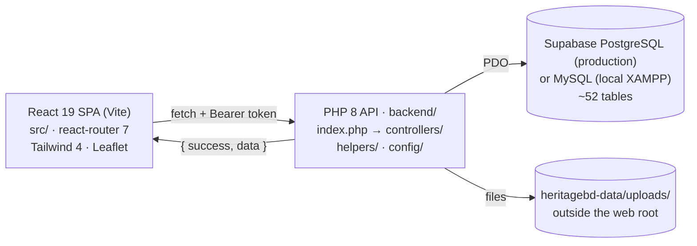

# Architecture



More diagrams (use cases, domain model, ER, sequences, state machines) are in
[diagrams.md](diagrams.md).

## Tech stack

| Layer | Technology |
|---|---|
| Frontend | React 19, React Router 7, TypeScript 5.7, Vite 8, Tailwind CSS 4, Leaflet / react-leaflet (maps), Recharts (dashboards), lucide-react (icons) |
| Backend | Plain PHP 8 (no framework), PDO with real prepared statements; `HeritagePDO` adapts the one MySQL/PostgreSQL difference (`LIKE` → `ILIKE`) |
| Database | **Supabase PostgreSQL 17** in production; MySQL 8 / MariaDB 10.4+ for local development. Chosen by `DATABASE_URL` / `DB_DRIVER` |
| Tooling | Figma Make scaffold (`.figma/make/`, custom Vite plugins in `vite.config.ts`), oxfmt formatter |

## Repository layout

```
heritage/
├── src/                     React app
│   ├── App.tsx              Router + RequireRole guard
│   ├── context/AppContext   Auth session, cart, notifications (global state)
│   ├── services/api.ts      Typed API client (single place that calls fetch)
│   ├── pages/               One folder per feature area (admin, auth, guide, marketplace, preorder, …)
│   ├── components/          cards/, layout/ (Navbar, Footer), local/ (LocalTaste), ui/ primitives
│   ├── data/                mockData.ts, preorderData.ts (legacy / fallback / status config)
│   ├── types/index.ts       Shared TypeScript models
│   └── imports/pasted_text/ Product specs used while building features (not runtime code)
├── backend/
│   ├── index.php            Front controller + regex route table
│   ├── config/              database.php (PDO for MySQL or PostgreSQL), cors.php
│   ├── helpers/             auth, throttle, areas (BD geography), response, notify, payments (demo stub), earnings (settlements)
│   ├── controllers/         One file per resource, plain functions `resource_action($pdo, ...$params)`
│   ├── database/            schema.sql, seed.sql (hand-maintained), migrations/ (002–006 + named)
│   └── tests/               settlement_smoke.php
├── scripts/                 generate-seed.cjs (original mockData → seed.sql; now stale, see database.md), strip-and-dump.cjs
├── heritagebd-data/uploads/ Runtime upload store (git-ignored)
└── docs/                    This documentation
```

## Request lifecycle (backend)

1. Apache `.htaccess` (or `php -S … index.php`) sends every request to `backend/index.php`.
2. `index.php` loads config, helpers and **every** controller file, then opens the PDO connection.
3. `config/cors.php` emits CORS headers and short-circuits `OPTIONS` with 204.
4. The path is normalised (base folder stripped) and matched against `$routes`, an ordered list of
   `[METHOD, regex, handler]`. Regex capture groups become handler arguments.
5. The handler calls `require_auth()` / `require_role()` as needed, does its work and ends with
   `json_ok()` / `json_error()` (both `exit`).
6. Any uncaught `Throwable` is logged with `error_log` and returned as a generic 500.

Route order matters: literal paths such as `/api/places/saved` are listed before
`/api/places/([\w-]+)`.

## Response envelope

```json
{ "success": true,  "data": { ... } }
{ "success": false, "message": "Human readable reason" }
```

## Frontend ↔ backend contract

- Base URL: `VITE_API_URL` (default `http://localhost:8080`); every call goes to `${VITE_API_URL}/api/...`.
- Token: stored in `localStorage` under `heritagebd_token`, sent as `Authorization: Bearer …`.
- A 401 clears the token and dispatches a `heritagebd:unauthorized` window event that resets `AppContext`.
- Image URLs: the client rewrites `/api/product-images/<id>` and `/api/profile-images/<id>` to absolute
  URLs on read and back to relative paths on write, so the DB never stores a host name.

## Real-time behaviour

There are no WebSockets. Chat polls every 5 s while open; notifications poll every 20 s while the tab
is visible (`AppContext.tsx`).

## Payments

All online payments are simulated (`helpers/payments.php`, `PAYMENTS_DEMO_MODE = true`). Amounts,
advances and settlements are recorded, but no gateway is called. See [workflows.md](workflows.md).
