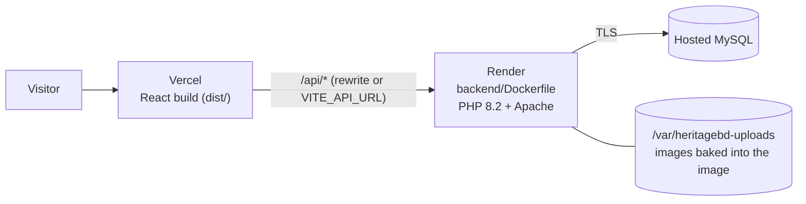

# Deploying to Vercel with the PHP backend

Vercel hosts the **React frontend** only: it has no built-in PHP runtime or MySQL. The backend runs as
a Docker container on a PHP-capable host (this guide uses **Render**; Railway, Fly.io or any VPS work
the same way), and the database on a **hosted MySQL** (Aiven, TiDB Cloud, PlanetScale, Railway…).



Order: **database → backend → frontend**, because each step needs the address of the previous one.

---

## 1. Database (hosted MySQL)

1. Create a MySQL 8 database with your provider. Note the **host, port, user, password, database
   name**, and download the **CA certificate** (TLS is required by most providers).
2. Load the schema and data. The SQL files start with `CREATE DATABASE heritagebd; USE heritagebd;`,
   which hosted databases usually don't allow, so strip those lines while importing:

   ```bash
   sed -E '/^(CREATE DATABASE|USE) /d' backend/database/schema.sql | mysql --ssl-ca=ca.pem -h HOST -P PORT -u USER -p DBNAME
   ```
   ```bash
   sed -E '/^(CREATE DATABASE|USE) /d' backend/database/seed.sql | mysql --ssl-ca=ca.pem -h HOST -P PORT -u USER -p DBNAME
   ```

   - `seed.sql` creates demo accounts that all use `password123`. For a real launch, skip it or
     change/delete those accounts immediately afterwards.
   - **Moving your existing local data instead?** Export it and import that dump:
     `C:\xampp\mysql\bin\mysqldump -u root --single-transaction heritagebd > heritagebd.sql`, then
     run the same `sed … | mysql …` command on `heritagebd.sql`. Make sure migrations 002–007 are
     applied locally first (see [database.md](database.md#migrations)).

## 2. Backend on Render (Docker)

The image is defined in [`backend/Dockerfile`](../backend/Dockerfile). It is built from the
**repository root** so the committed images in `heritagebd-data/uploads/products` and `/profiles`
are copied in; the root [`.dockerignore`](../.dockerignore) keeps everything else (node_modules,
src, private documents) out.

1. Push the repo to GitHub (already at `Monika-Akter47/heritagebd`).
2. Render → **New → Web Service** → connect the repo.
3. Settings:

   | Setting | Value |
   |---|---|
   | Language / Runtime | **Docker** |
   | Dockerfile Path | `backend/Dockerfile` |
   | Docker Build Context Directory | `.` (repo root, **not** `backend`) |
   | Health Check Path | `/api/payment-terms` |

4. Environment variables:

   | Variable | Value |
   |---|---|
   | `DB_HOST`, `DB_PORT`, `DB_NAME`, `DB_USER`, `DB_PASS` | From step 1 |
   | `DB_SSL_CA_PEM` | The CA certificate's full text. Paste it as-is, or on one line with `\n` between lines |
   | `CORS_ORIGIN` | Your Vercel URL, e.g. `https://heritagebd.vercel.app` (no trailing slash). Not needed if you use the rewrite in step 3 option A |
   | `APP_TIMEZONE` | `Asia/Dhaka` (default) |

   `HERITAGE_UPLOAD_DIR` is already set inside the image; don't override it.

5. Deploy, then check: `https://YOUR-API.onrender.com/api/places` returns JSON, and an image such as
   `https://YOUR-API.onrender.com/api/product-images/a2998d77660b2504af2ab639b4268df4` shows the
   HeritageBD placeholder.

**About uploads on Render:** images committed to git are inside the image and always available. Files
uploaded through the site after deploy (new product photos, verification documents) are written to the
container's disk, which on the **free plan is wiped on every restart or redeploy**. For real use, add a
Render **persistent disk** mounted at `/var/heritagebd-uploads` (paid plans). With a disk mounted, the
baked-in images are hidden by the empty disk on first boot, so copy `heritagebd-data/uploads/products`
and `/profiles` onto the disk once (Render shell, `scp`, or upload through the admin pages). Back the
disk up together with the database.

The free plan also sleeps after ~15 minutes idle; the first request afterwards takes 30–60 s.

## 3. Frontend on Vercel

[`vercel.json`](../vercel.json) already sets the framework (Vite), build command, `dist` output and the
SPA fallback, so deep links like `/places/p1` work.

1. Vercel → **Add New → Project** → import the GitHub repo. Root directory: the repo root.
2. Connect it to the backend with **one** of these:

### Option A (recommended): same-origin rewrite, no CORS

Vercel forwards `/api/*` to Render, so the browser only ever talks to your Vercel domain. Images,
logins and preview deployments all work without CORS settings, and you don't set `VITE_API_URL`
(production builds then use the site's own origin; see `src/services/api.ts`).

Edit `vercel.json`, putting the API rule **first**:

```json
{
  "$schema": "https://openapi.vercel.sh/vercel.json",
  "framework": "vite",
  "buildCommand": "npm run build",
  "outputDirectory": "dist",
  "rewrites": [
    { "source": "/api/:path*", "destination": "https://YOUR-API.onrender.com/api/:path*" },
    { "source": "/((?!assets/).*)", "destination": "/index.html" }
  ]
}
```

### Option B: call the API directly

In Vercel → Project → **Settings → Environment Variables**, add
`VITE_API_URL = https://YOUR-API.onrender.com` (no trailing slash) for Production (and Preview), then
redeploy. It's read at **build** time, so changing it requires a new deployment. Set the backend's
`CORS_ORIGIN` to your exact Vercel URL. Preview URLs (`*-git-branch.vercel.app`) differ from it and
will be blocked by CORS; use option A if you need previews.

3. Deploy. The page title "HeritageBD – Explore Bangladesh's Heritage" comes from
   `.figma/make/site.json`.

## 4. Check the live site

- [ ] Home page loads, place/product images show (open DevTools → Network: image requests return 200).
- [ ] Open `/places/p1` directly in a new tab (SPA fallback works).
- [ ] Log in, add to cart, check out; order tracking shows the 20% advance.
- [ ] `/shop?area=Sylhet` shows traditional foods and products.
- [ ] Admin → upload a photo, refresh, it's still there (and remember the free-plan disk note).
- [ ] No `localhost` in any request URL.

## Troubleshooting

| Symptom | Cause / fix |
|---|---|
| All API calls go to `http://localhost:8080` | Built in development mode, or an old build. Redeploy; production builds never use localhost |
| "Failed to fetch" / CORS error in console | Option B without the right `CORS_ORIGIN`, or calling from a preview URL. Use option A, or fix `CORS_ORIGIN` |
| `Database connection failed` | Wrong `DB_*` values, missing `DB_SSL_CA_PEM`, or the provider's IP allow-list blocks Render. Check Render logs |
| Images 404, API works | Image built with context `backend` instead of `.`, or a persistent disk mounted without copying the images onto it |
| Uploaded photos vanish after a while | Render free-plan disk is ephemeral; add a persistent disk |
| 404 on refreshing a page like `/shop` | `vercel.json` rewrite missing or the API rule placed after the SPA rule |
| First request very slow | Render free plan waking from sleep |
| Login returns 500 | Migrations not applied on the hosted database (needs `auth_attempts` from 005); import a full dump or apply migrations |
| Password-reset email never arrives | The container has no mail transport for PHP `mail()`; configure SMTP before relying on it |

## Not covered by this setup

- **Payments** are still simulated (`PAYMENTS_DEMO_MODE`); no money moves.
- **Vercel-only PHP** (community `vercel-php` runtime) is possible but unsuitable here: serverless
  functions have no persistent disk for uploads.
