# UML diagrams

All diagrams are [Mermaid](https://mermaid.js.org/), which GitHub, GitLab and VS Code (with the
Markdown Mermaid extension) render inline. They describe the code as of 2026-10-24; the
controller and table names match the source.

| # | Diagram | UML type |
|---|---|---|
| 1 | [System context](#1-system-context) | Component / deployment |
| 2 | [Use cases by role](#2-use-cases-by-role) | Use case (as flowchart) |
| 3 | [Domain model](#3-domain-model) | Class |
| 4 | [Database relationships](#4-database-relationships) | Entity–relationship |
| 5 | [Request lifecycle](#5-request-lifecycle) | Sequence |
| 6 | [Login with rate limiting](#6-login-with-rate-limiting) | Sequence |
| 7 | [Marketplace order and settlement](#7-marketplace-order-and-settlement) | Sequence |
| 8 | [Guide booking and settlement](#8-guide-booking-and-settlement) | Sequence |
| 9 | [Order states](#9-order-states) | State machine |
| 10 | [Pre-order states](#10-pre-order-states) | State machine |
| 11 | [Guide booking states](#11-guide-booking-states) | State machine |
| 12 | [Local foods and products by area](#12-local-foods-and-products-by-area) | Sequence |
| 13 | [Frontend component structure](#13-frontend-component-structure) | Component |

---

## 1. System context

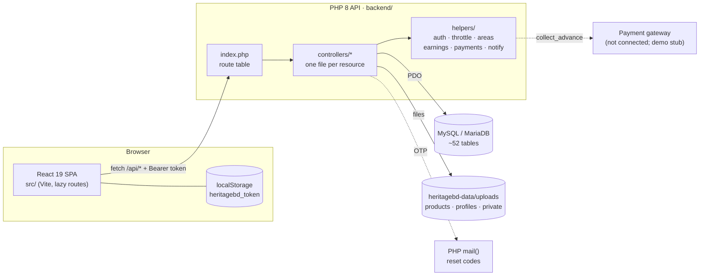

## 2. Use cases by role

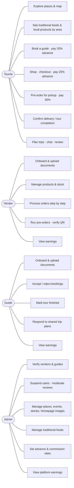

## 3. Domain model

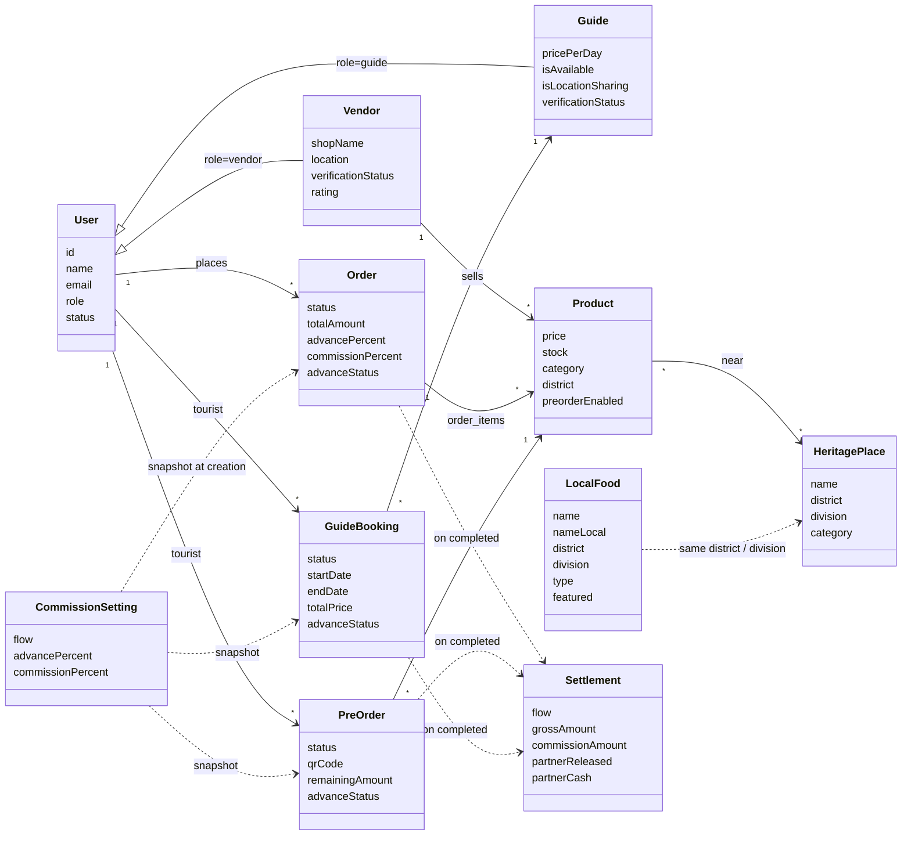

## 4. Database relationships

Core tables only; child tables such as `product_images` or `guide_languages` are omitted.

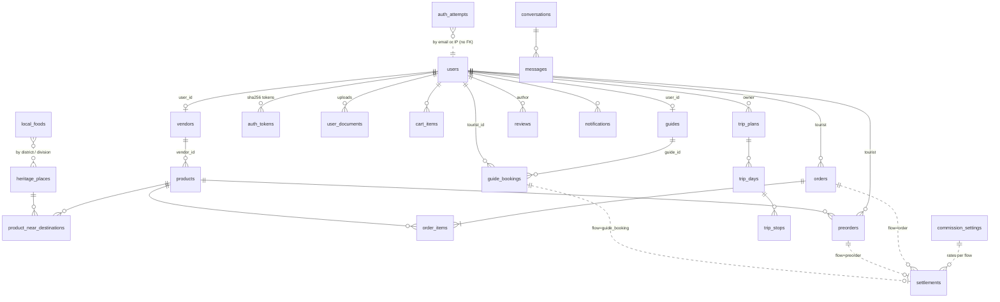

## 5. Request lifecycle

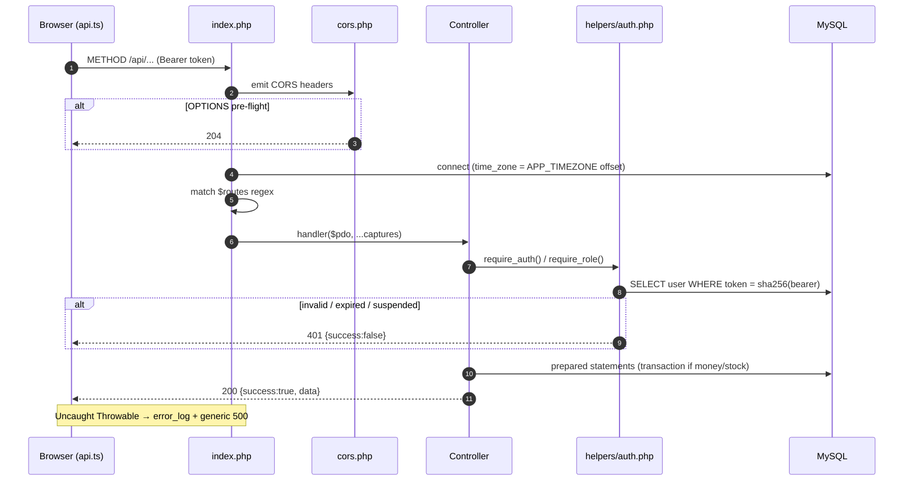

## 6. Login with rate limiting

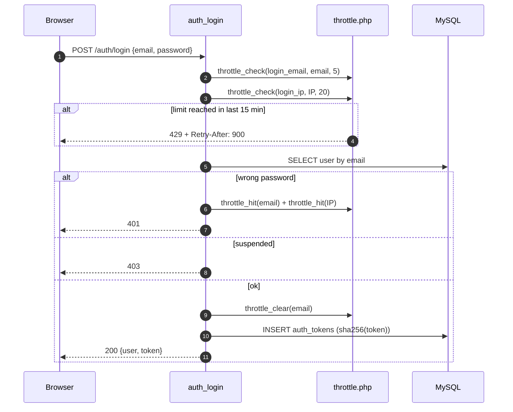

## 7. Marketplace order and settlement

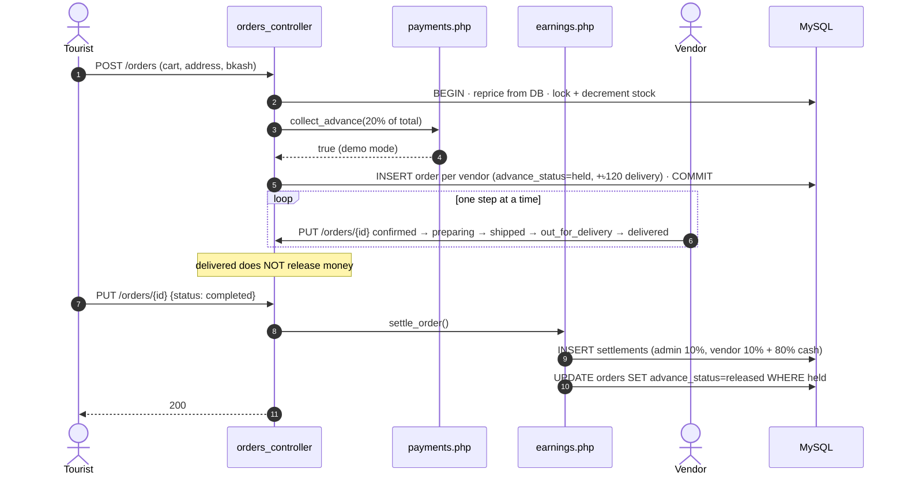

## 8. Guide booking and settlement

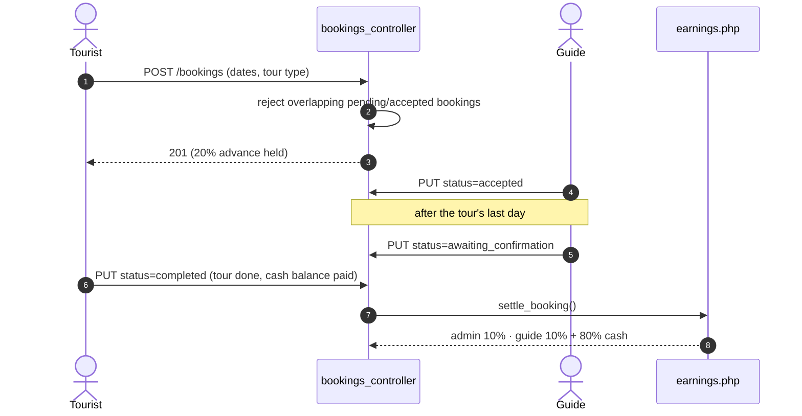

## 9. Order states

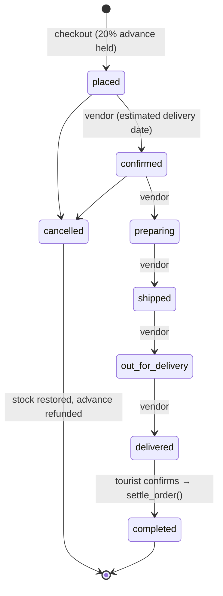

## 10. Pre-order states

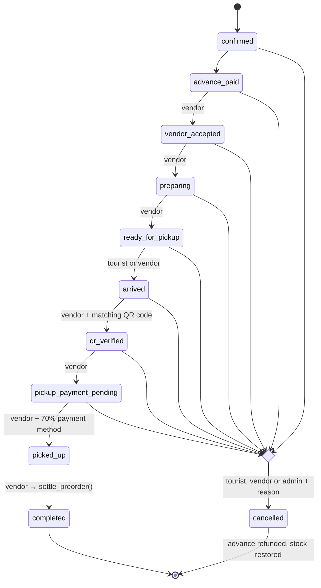

> `refunded` exists in the enum and is admin-only in `PREORDER_TRANSITION_ROLES`, but no state lists
> it as a next step, so it can't currently be reached. See [known-issues.md](known-issues.md).

## 11. Guide booking states

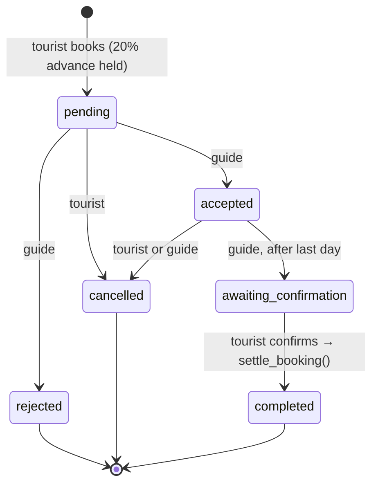

## 12. Local foods and products by area

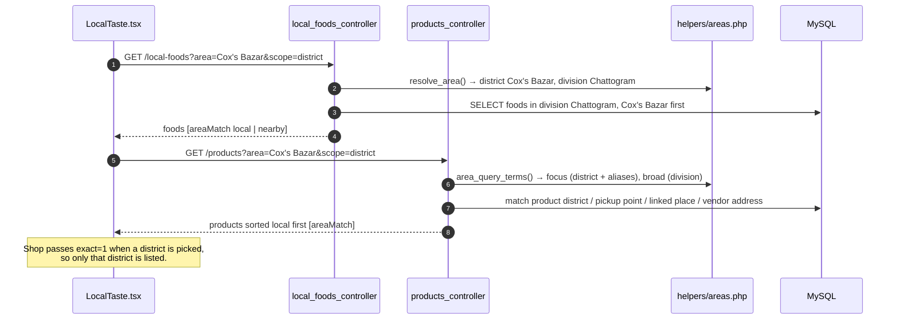

## 13. Frontend component structure

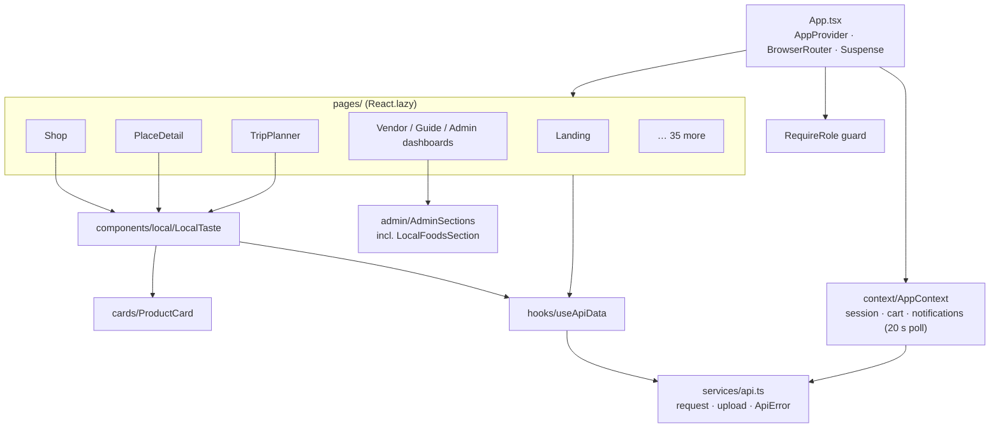
